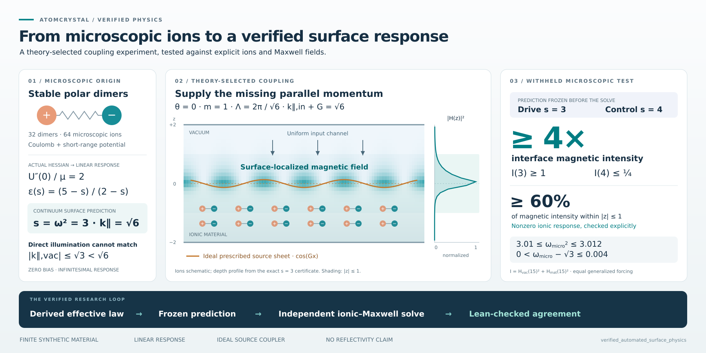

# Physics research experiments

Experiments in automated physics research, combining microscopic models,
simulated experiments, effective theories, and Lean-checked mathematical
results. The aim is to make the research process inspectable: what was assumed,
what was predicted before testing, what failed, and exactly what was proved.

This repository contains two separate projects with different verification
and data-retention scopes.

## Atomcrystal: microscopic ions to surface-field enhancement



[`atomcrystal/`](atomcrystal/README.md) completes a finite-model research loop:

```text
nonlinear ionic potential → bulk dielectric law → continuum surface mode
→ momentum-matched experiment → independent microscopic driven calculation
→ certified observable and discrepancy bounds
```

The model is a finite polar-dimer crystal with 64 ions and explicit Maxwell
fields. The effective theory identifies a parallel-momentum mismatch and
selects a periodic source. A prediction frozen before the driven calculation
is then validated by exact rational certificates checked in Lean.

The [headline theorem](atomcrystal/VerifiedPhysics/Final/MainTheorem.lean),
`verified_automated_surface_physics`, combines a surface eigenfrequency bound
of `0 < ω_micro − √3 ≤ 0.004` with a driven interface magnetic-intensity
contrast of at least four and at least 60% near-interface magnetic localization.
Earlier failed predictions remain part of the research record.

This is linear response in a specified synthetic material, using an ideal
prescribed periodic source. It does not prove real NaCl behavior, passive-grating
efficiency, or open-boundary reflectivity. Proof sources, certificates, frozen
predictions, and provenance records are included.

See the [project README](atomcrystal/README.md) for assumptions and error budgets,
the [final report](atomcrystal/artifacts/scattering_report.md) for the research
outcome, and the [submission guide](atomcrystal/SUBMISSION.md) for repository
and verification details.

## Lattice gas: finite-volume fluctuations and scattering

[`latticegas/`](latticegas/README.md) explores local lattice interactions,
density fluctuations, finite-volume Binder crossings, and synthetic scattering
enhancement. It includes simulation code, conditional Lean theorems, and
historical reports covering both successful finite-volume comparisons and
a failed exploratory exponent-compatibility test.

This project is a lightweight source-only archive: its original generated
samples, random streams, and numerical certificates were removed. The Lean
theorems check conditional mathematical implications; the historical empirical
premises cannot be independently re-audited from this checkout alone.
New simulations do not restore the deleted historical samples.

See the [project README](latticegas/README.md) for dependency setup and rerun
instructions, and the [report index](latticegas/reports/README.md) for the
findings and their limitations.

## Verify atomcrystal

The source and provenance checks require only Python 3. From the repository root:

```sh
python3 -B atomcrystal/scripts/audit.py
python3 -B atomcrystal/scripts/scattering_provenance.py verify
python3 -B atomcrystal/scripts/scattering.py --check
```

For the full proof build, install Lean through elan, then use the pinned
toolchain and dependency manifest:

```sh
cd atomcrystal
lake exe cache get
lake build
lake env leanchecker VerifiedPhysics.Final.MainTheorem
lake build VerifiedPhysics.Final.Audit
```

The [GitHub workflow](.github/workflows/verify.yml) runs atomcrystal's build,
independent proof checking, certificate regeneration, and provenance audits.
It does not currently verify the lattice-gas project.

Downloaded dependencies and build products are excluded from version control
and are restored when building. Atomcrystal's `artifacts/` directory contains
required scientific evidence and must be retained. Repository-wide LF
line-ending rules preserve its frozen source hashes across checkouts.
