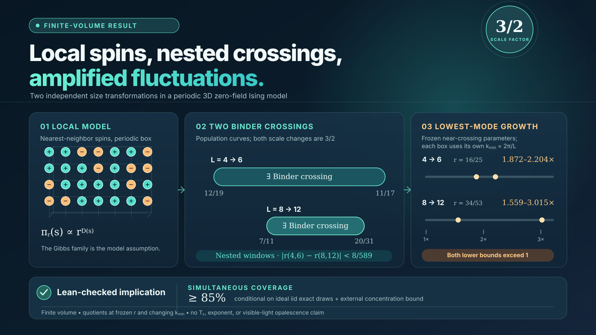

# Multiscale lattice-gas research experiment



The [final grand-canonical report](reports/GrandCanonicalFinalReport.md) describes two nested finite-volume Binder crossings and two longest-mode amplification results. The deterministic implication from the reported endpoint premises is packaged in [GrandCanonicalFinal.lean](lean/GrandCanonicalFinal.lean). The prior [phenomenological-RG follow-up](reports/GrandCanonicalPRGStage5Report.md) retains the failed exploratory two-pair exponent-compatibility test. The older canonical first pass described below is a separate ensemble and its data were not pooled with the grand-canonical branch.

**Lightweight checkout:** At the user's request, all generated experiment records, random streams, plots, certificates, build trees, local toolchains, and downloaded dependencies were removed. The reports remain as historical documents, but their numerical claims cannot be independently re-audited from this checkout alone. Lean verifies the conditional mathematics; it does not establish the deleted empirical premises. The removed raw records are not stored in this repository.

This workspace contains an executable and formally grounded first pass at the chain

```
local lattice interactions → density fluctuations → candidate correlation length
→ candidate critical region → conditional synthetic scattering enhancement
```

The [research report](reports/REPORT.md) gives the result and its limits. The central finding is a roughly ninefold enhancement of the lowest accessible scattering mode between two rational control parameters on an L=12 box. Critical-point and exponent claims are not certified because initial-state dependence remains after finite equilibration.

The proof files are [LatticeGas.lean](lean/LatticeGas.lean), [LatticeGasStats.lean](lean/LatticeGasStats.lean), [LatticeGasScattering.lean](lean/LatticeGasScattering.lean), and [LatticeGasNumerics.lean](lean/LatticeGasNumerics.lean). The simulator is [simulator.cpp](src/simulator.cpp); [research.py](scripts/research.py) chooses staged experiments from previous observations; [finalize.py](scripts/finalize.py) builds derived data, plots, the experiment log, and provenance graph.

## Reproduce

This repository pins Lean v4.34.1 in `lean-toolchain` and uses Physlib commit
`89d99e898104b7ffd93df322e0ab1ea999645116`. The local `vendor/physlib`,
`.elan`, `.lake`, and compiled binaries are ignored and absent. On a fresh checkout,
install [elan](https://github.com/leanprover/elan), then fetch the pinned dependency:

```sh
git clone https://github.com/leanprover-community/physlib.git vendor/physlib
git -C vendor/physlib checkout 89d99e898104b7ffd93df322e0ab1ea999645116
lake build GrandCanonicalFinal
lake env leanchecker GrandCanonicalFinal
lake env lean lean/GrandCanonicalAudit.lean
```

The following commands rerun the older canonical branch; they do not restore the deleted historical samples:

```sh
python3 scripts/research.py stage1
python3 scripts/research.py stage2
python3 scripts/research.py stage3
python3 scripts/research.py stage4
python3 scripts/research.py stage5
python3 scripts/validate_small.py
python3 scripts/finalize.py
python3 scripts/verify_numerics.py
python3 scripts/exact_modes.py
```

These commands require Python 3, NumPy, and g++. The stage functions reuse an existing raw file of the exact expected name; rename it before an intentional rerun. Stage 1–3 use only local nearest-neighbor Kawasaki steps. Stage 4 adds an explicitly recorded global-swap preparation burn, followed by local steps. One terminal snapshot is measured per independently seeded replica. The pseudorandom streams are deterministic; the statistical interpretation in the report remains conditional on ideal independent equilibrium sampling.

## Data and build artifacts

The output directories are empty placeholders. Generated raw data, CFTP
random streams, statistical certificates, plots, binaries, Lean build outputs,
and downloaded dependencies are excluded by [`.gitignore`](.gitignore). To
recheck the empirical conclusions, new experiments must be run; this checkout
does not contain the original samples or their hash certificates. The Lean
theorems remain checkable after fetching the pinned dependencies above.

Source is grouped under [`lean/`](lean), [`src/`](src), and
[`scripts/`](scripts/README.md); the [report index](reports/README.md) collects
the final and historical findings.
The data and result directory names remain in place so the existing scripts
can write new outputs. Small relative symlinks inside `scripts/` preserve their
historical path layout without duplicating source or data.
