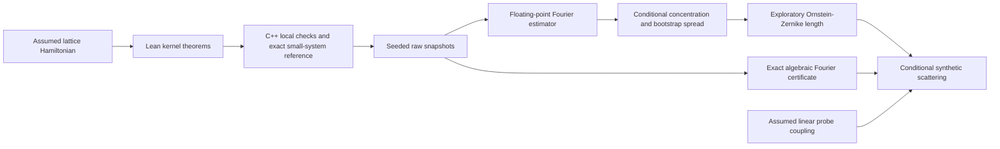

# Automated lattice-gas research: first-pass report

## Outcome

A finite, half-filled three-dimensional lattice gas produced a reproducible ninefold increase in the lowest accessible density-scattering mode between $q=4/5$ and $q=3/7$ on $L=12$. The rational microscopic Markov kernel, including detailed balance and stationarity, is proved in Lean. A linear probe's scattering-amplitude identity is also proved.

This is a **conditional synthetic scattering prediction**, not a certified discovery of a critical exponent or visible-light opalescence. Random and slab initializations still disagree near the suspected transition after long local exchange runs and after auxiliary global-swap preparation. That unresolved mixing bias prevents a trustworthy equilibrium confidence interval for the correlation length, critical parameter, exponent, or scattering ratio. The raw data and rejected hypotheses are retained.

| Status | Claim and domain | Remaining uncertainty |
| --- | --- | --- |
| Assumed | Finite periodic lattice gas; ideal random proposal stream; external linear probe coupling | Physical applicability and actual PRNG independence |
| Formally proved | Exact rational local kernel, detailed balance, stationarity; linear probe amplitude identity | External C++ correspondence and electromagnetic approximation |
| Numerically certified | Exact algebraic $L=12$ axis powers conditional on extracted bits; 9–10 near/far ratio from those coefficients | Bit-to-certificate extraction is external code |
| Statistically conditional | Bounded-event Hoeffding intervals under independent equilibrium replicas | Finite-burn equilibrium is unverified |
| Empirical effective law | Two-mode $\xi$ on selected warm-side discrete modes, with mode-3 holdout | Initialization bias and model failures at some parameters |
| Extrapolation / heuristic | Candidate $q_c$, exponent, and optical-depth onset | No certified thermodynamic or visible-light prediction |

## Assumptions and exact results

The physical assumption is occupation $n_x∈\{0,1\}$ on an $L^3$ periodic cubic lattice with $N=L^3/2$ for even $L$, and $H=-J\sum_{\langle x,y\rangle}n_xn_y$. We set $J=1$ in the executable model. The control parameter is rational $q∈(0,1)$. A step chooses uniformly among the $3L^3$ positive-direction nearest-neighbor bonds, proposes exchanging their occupations, and accepts with $q^{\max(0,H_{\rm new}-H_{\rm old})}$; otherwise it stays put. One may interpret $q=e^{-J/T}$, but no exponential evaluation is part of the kernel.

[LatticeGas.lean](../lean/LatticeGas.lean) proves finiteness, particle conservation, move involution, nonnegative and normalized transition rows, exact proposal detailed balance, full-kernel detailed balance, and stationarity of the unnormalized weight $q^H$. The state count may be zero for invalid $N$, in which case the row theorem is vacuous. No translation/rotation symmetry theorem is claimed. Mathlib supplies the finite-sum and probability abstractions; no physlib lattice-gas abstraction was available.

The C++ simulator implements the same stated exchange rule with integer energies and exact rational acceptance comparisons. Its PRNG is deterministic SplitMix64 with unbiased bounded-integer rejection. The program is external code: **its equivalence to the Lean function is not proved**. Runtime checks compared local energy differences with a full Hamiltonian recomputation and checked particle count. An exact Fraction-based exhaustive reference check of all 70 half-filled $L=2$ states verified row sums and detailed balance. Two representative original data files replayed bit-for-bit with the current executable. These are validation evidence, not a universal correspondence proof.

## Experiments and automated decisions

The controller began with the weak hypothesis that the smallest Fourier mode is rarely large at high $q$. It scanned $q=4/5,2/3,1/2,2/5,1/3$ at $L=6$, then selected the largest adjacent rise in measured $S(k_{\min})$, refined it at $q=3/8$, and enlarged the box to $L=8,10,12$. The continued size dependence led it to test the warm side and two initial conditions. Failed initialization agreement led to an auxiliary global-swap equilibration experiment. [The structured log](../results/experiment_log.json) records each question, observation, and decision.

At $L=6$, the event $S_{\rm snapshot}(k_{\min})>3$ occurred in 0 of 64 replicas at $q=4/5$ and 53 of 64 at $q=1/3$. Hoeffding intervals with a five-comparison union budget are respectively $[0,0.203]$ and $[0.625,1]$. This is a conditional 95% familywise statement **if** the terminal configurations are independent equilibrium draws under ideal randomness. Seeded pseudorandom chains and a finite burn do not establish that premise. [LatticeGasStats.lean](../lean/LatticeGasStats.lean) proves a conditional one-sided probability bound from independence and sub-Gaussian assumptions via mathlib. The application of the Bernoulli bound and the numerical exponential evaluation remain outside that Lean proof.

The lowest-mode means grew with box size. For $q=2/5$, $S(k_{\min})$ was 2.87, 5.70, 8.94, and 11.82 at $L=6,8,10,12$, respectively. Descriptive log-log slopes across these four sizes were 2.06 at $q=2/5$, 2.68 at $3/8$, and 3.02 at $1/3$. These slopes do not establish a thermodynamic singularity. The distribution and equilibration change with $L$.

## Emergent model and its failures

We tested $S(k)=A/(\widehat k^2+\xi^{-2})$, with $\widehat k^2=4\sin^2(k/2)$. Modes 1 and 2 set $A,\xi$; mode 3 was a predeclared holdout. The criterion required its absolute prediction error to beat a flat two-mode model and be no more than two descriptive standard errors of mode 3. This is a discrete three-mode check, not a uniform-in-$k$ bound.

For $L=12$ auxiliary-prepared random starts, the inferred $\xi$ in lattice spacings was 1.09 at $q=1/2$, 1.40 at $8/17$, 1.75 at $5/11$, 2.23 at $4/9$, and 4.51 at $3/7$. The holdout criterion failed at $4/9$. At $2/5$, the two-mode fit has negative mass squared and the stated Ornstein-Zernike form fails. At $3/7$, 11.3% of replica-bootstrap resamples also fail to give a positive length; the reported percentile range among valid resamples is 2.58–14.93. Thus the long length is suggestive and sensitive to the effective model.

Initialization is the larger discrepancy. At $q=3/7$, the auxiliary-prepared $L=12$ $S_1$ means are 6.82 from random starts and 8.30 from slab starts; the slab spectrum does not yield a positive two-mode mass. At $q=5/11$, $\xi$ is 1.75 versus 3.61. Even 10,000 local sweeps did not erase start-state differences. This difference is separate from Monte Carlo spread and from effective-law holdout error.

With a longer 5,000-sweep global-swap burn, $S_1$ at $q=5/11$ moved closer (3.92 random versus 4.38 slab), whereas at $q=3/7$ it remained far apart (7.51 versus 4.93). The direction of the difference even reversed. This failed convergence check strengthens the decision to withhold an equilibrium critical-law claim.

A diagnostic four-point fit over only holdout-passing warm-side points gives $q_c≈0.424$, $\nu≈0.52$, and $C≈0.29$ for $\xi=C(q-q_c)^{-\nu}$. It has no defensible confidence interval: four points leave one residual degree of freedom, finite-size bias is unbounded, and the start-state discrepancy changes the fitted inputs. The candidate transition region $q≈0.40$–$0.43$ is therefore a search target, not a measured critical-point interval. No known exponent was inserted into this fit.

## Conditional scattering prediction

Assume a weak linear dielectric response $\delta\epsilon_x=a\,\delta\rho_x$ and a probe with wavevector $k=(2\pi/12,0,0)$, which lies on the measured lattice grid. [LatticeGasScattering.lean](../lean/LatticeGasScattering.lean) proves exactly that the squared Fourier amplitude is $|a|^2$ times the density Fourier power. Maxwell propagation, the value of $a$, and the weak-scattering approximation are external assumptions.

Setting $|a|^2=1$ for a synthetic relative probe gives $S_1=0.747$ at $q=4/5$, $6.819$ at $3/7$, and $11.458$ at $2/5$, all using the same $L=12$ auxiliary/random protocol. The near/far intensity ratio is 9.13; a replica bootstrap gives a **descriptive sampling-only** 2.5–97.5% range of 7.79–10.77. It excludes mixing, finite-size, constitutive, and multiple-scattering error. If an external path factor is chosen as $C=0.1$, the synthetic optical depths $CS_1$ are 0.075, 0.682, and 1.146. The last value marks the approach to strong attenuation in an added independent-scattering path model; validity of that model at order-one depth is not established. No visible-light wavelength is simulated or extrapolated.

For the measured $L=12$ axis modes, the recorded bits also yield exact Fourier powers in $\mathbb Q(\sqrt3)$. [The exact interval certificate](../results/exact_spectrum_intervals.json) brackets every tested mean with rational endpoints of width below $4×10^{-40}$. [LatticeGasNumerics.lean](../lean/LatticeGasNumerics.lean) checks the square-root bracket and proves that the near/far ratio lies strictly between 9 and 10 **given the extracted integer coefficients**. Extraction of those coefficients from raw JSONL is independently checked by the FFT and direct DFT but is not proved in Lean. This closes the material floating-point error for the reported contrast; it does not close sampling or equilibration uncertainty.

## Verification boundary

The full [machine-readable graph](../results/provenance.json) marks each node as assumed, formally proved, numerically checked, empirically inferred, or heuristic. Its open edges are C++/Lean implementation equivalence, finite-burn equilibrium, raw-bit-to-certificate extraction, nonlinear-fit coverage, and finite-size extrapolation. A direct DFT cross-check over 10,368 mode calculations found a maximum absolute $S$ difference of $8.53×10^{-14}$ from the FFT; this is an independent numerical check, not a formal error bound for the survey data.

[Raw snapshots](../data/raw), their [manifest and hashes](../results/manifest.json), [machine-readable estimates](../results/derived.json), and five plots are retained: [structure factor](../results/plots/structure_factor.svg), [correlation length](../results/plots/correlation_length.svg), [finite size](../results/plots/finite_size.svg), [scaling diagnostic](../results/plots/scaling_fit.svg), and [synthetic scattering](../results/plots/scattering.svg).

## Status and next experiment

Milestone 1 is partial: the Lean mathematical kernel is proved and the simulator data are reproducible, but external implementation correspondence is validated only by checks. Milestone 2 is reached as a conditional anomaly detection. Milestone 3 has an exploratory length trend, with failure at some parameters. Milestones 4 and 5 remain conditional, and universality was not attempted. The next decisive experiment is a demonstrably converged canonical sampler or a validated coupling argument at $L=12$ and larger, followed by independent start-state agreement and a new scaling fit. The present data must not be promoted to an equilibrium critical exponent.
